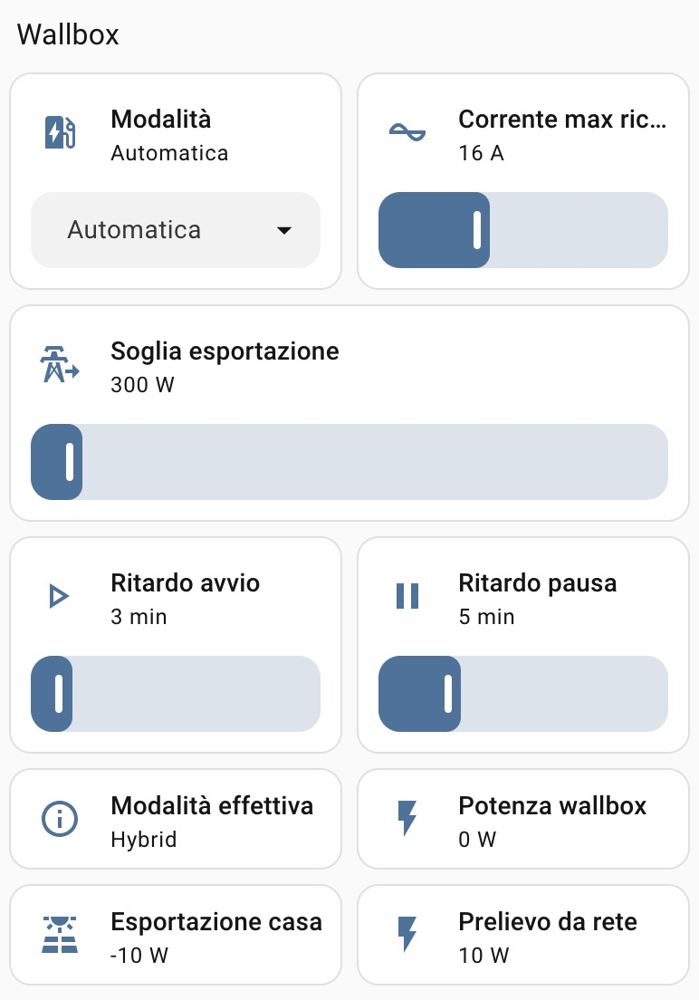

# Silla Prism – mode selector and PV-surplus automation for Home Assistant



A Home Assistant package for the **Silla Prism Solar** EV charger that adds:

- a **mode selector** with all the Prism modes, **including Hybrid**, which the official integration does not expose yet;
- an **Automatic** mode: Hybrid when there is enough PV surplus, Pause when there is not, with adjustable threshold and delays;
- **two-way sync** with the Silla app and the touch button: a mode changed there is reflected in Home Assistant;
- **Pause that survives the end of a session**: Pause is re-applied when the car is plugged in again or after the Prism reboots (e.g. after a power cut).

It talks to the Prism over its native local MQTT protocol, works alongside the official
[Silla Prism integration](https://www.home-assistant.io/integrations/silla_prism/), and needs nothing else:
no custom components, no cloud, no inverter integration.

<br clear="left">

## Why

- **Hybrid** (charge at the minimum current, topping up from the grid only what the PV cannot cover)
  is the most useful mode with a home PV system, but it is missing from the official integration.
- **OnlySun at night** keeps retrying to start: on firmware 4.4.8 about every 10 minutes, each attempt
  briefly drawing up to the maximum current (≈4.3 kW at 20 A) before backing off. Automatic mode keeps the Prism
  in Pause instead.
- **Pause is not a mode, it is a session state**: it is lost when the cable is unplugged or the Prism reboots,
  and the Prism falls back to its base mode (and starts charging, with autostart on).

## How Automatic works

The package creates `sensor.prism_available_surplus`:

```
available surplus = wallbox power − grid exchange (import positive)
```

i.e. *what the site would export if the wallbox were off*. Both values come from the Prism itself
(its meter sensor is installed at the utility meter, upstream of every load), so the formula works with any
topology: with or without a home battery, and whether the wallbox is upstream or downstream of an inverter's own meter.
On the author's system it matched the inverter's export meter within 26 W on average (215 readings, with the wallbox
charging up to 3 kW).

In **Automatic**:

- surplus **above** the threshold for the *start delay* → **Hybrid**;
- surplus **below** the threshold for the *pause delay* → **Pause**.

The condition must hold for the **whole** delay: a short dip or spike restarts the count. Changing the threshold is
evaluated immediately, but still goes through the delay, so raising it during a short household peak does not stop
the charge.

The threshold sets how much grid draw you accept: in Hybrid at 6 A (≈1.4 kW single-phase) the grid supplies roughly
1.4 kW minus the surplus.

## Requirements

- Home Assistant 2026.9 or later, with the **MQTT** integration and the official **Silla Prism** integration.
- The Prism connected to your broker (Silla app → *Access and communication* → *Custom MQTT*).
- Packages enabled in `configuration.yaml`:
  ```yaml
  homeassistant:
    packages: !include_dir_named packages
  ```

## Installation

1. Copy `packages/silla_prism_automation.yaml` into `/config/packages/`.
2. Open it and **replace four values** everywhere (find-and-replace):

   | Placeholder | Replace with |
   |---|---|
   | `prism/` | your MQTT base topic **with** trailing slash. The Silla app default is `home/prism/` |
   | `sensor.silla_prism_status` | the *Status* sensor of the official integration |
   | `sensor.silla_prism_power` | the *Power* sensor (its entity ID depends on your HA language, e.g. `sensor.silla_prism_potenza` in Italian) |
   | `sensor.silla_prism_grid_power` | the *Grid power* sensor |

3. *Developer tools → YAML → Check configuration*, then restart Home Assistant.
4. Set the threshold and delays from the dashboard (they start at their minimum values), then choose a mode.

## Dashboard

A suggested section (tile cards):

- `input_select.prism_mode` with the *Select options* feature;
- the official *Maximum charging current* number with a slider;
- `input_number.prism_surplus_threshold`, `prism_start_delay`, `prism_pause_delay` with sliders,
  visible only when `input_select.prism_mode` is `Automatic`;
- `input_text.prism_effective_mode`, the Prism power, `sensor.prism_available_surplus`, the Prism grid power.

## Prism behaviour observed (firmware 4.4.8)

Verified with MQTT logs and the Home Assistant recorder; the Hybrid code was confirmed by Silla support.

| | |
|---|---|
| Mode codes | `1` Solar/OnlySun · `2` Boost/Normal · `3` Pause · **`4` Hybrid** (not in the MQTT manual 4.0, confirmed by Silla) · `7` pause by load balancing (status only) |
| Republishing | `mode`, `state`, `pilot` are republished every 5 min with the car connected (~6 min without), even if unchanged; `user_amp` more often |
| Pause | applied only with the car connected; with the cable unplugged `set_mode 3` answers `success` but has no effect (confirmed by Silla); unplugging or a reboot drops it |
| `commandresult/…/success` | means *received*, not *applied* |
| Reconnection | `mode` is published **before** `hello`; no last-will message, so a vanished Prism is not detected |
| Start of a session / resume | pilot briefly at 32 A, then at the **maximum current** for a few seconds, then regulated |
| Switching to Boost while charging | the current ramps up 2 A every ~6 s |
| Grid target | in Hybrid the Prism keeps ≈100 W of grid draw; the OnlySun target set in the app does **not** apply to Hybrid (Silla). Silla advises against OnlySun targets between −50 and 50 W |
| Hybrid minimum current | set in the app only with the cable unplugged; not available over MQTT |
| Load balancing | in Boost the current is reduced to stay within the configured meter power |

## Limitations

- After plugging in or after a Prism reboot, the Prism may charge for a few seconds in its base mode before Home
  Assistant re-applies Pause (on the author's system the Pause usually arrived within the same second).
- The surplus is instantaneous (updated every second): brief spikes restart the delay count, so Pause can come a few
  minutes later than expected on a variable afternoon.
- Single-port Prism only (port `1`). Tested on one single-phase Prism Solar with firmware 4.4.8.
- Home Assistant restarts: the automatic triggers start "at rest" and act on the next change of conditions.

## About this project

The package was written with the assistance of an AI model (Anthropic's Claude) and designed, tested and validated
by the author on a real installation over several days, including power cuts and plug/unplug cycles.
Issues and pull requests are welcome.

## License

[MIT](LICENSE)
